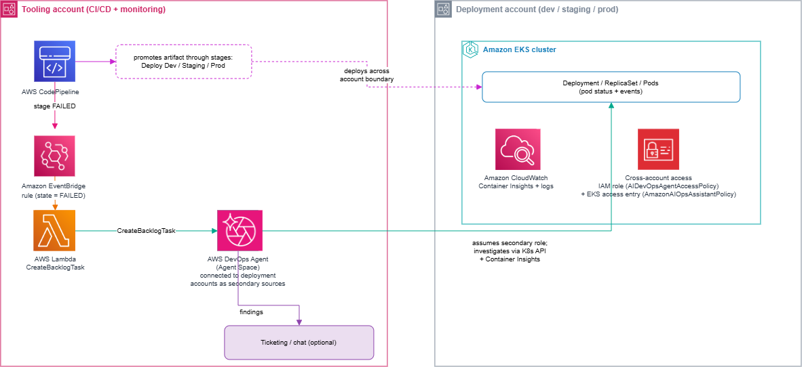

# Automating Cross-Account EKS Deployment Failure Investigation with AWS DevOps Agent

This sample deploys an event-driven integration that routes AWS CodePipeline deployment stage failures to AWS DevOps Agent for autonomous cross-account investigation of Amazon EKS workloads.

When a pipeline stage fails while deploying to an EKS cluster in a different AWS account, DevOps Agent assumes a role into that deployment account, inspects the cluster state through the Kubernetes API, correlates pod events and container logs, and reports which cluster, and pod failed and why.

This repository contains the integration only. It assumes you already run CodePipeline in a tooling account and Amazon EKS clusters in one or more deployment accounts.

## Architecture



The architecture consists of the following components:

1. AWS CodePipeline promotes a build artifact through deployment stages, each targeting an EKS cluster in a different account
2. Amazon EventBridge rule matches `CodePipeline Stage Execution State Change` events with state `FAILED`
3. AWS Lambda calls the DevOps Agent `CreateBacklogTask` API to create a HIGH priority INVESTIGATION task
4. AWS DevOps Agent assumes the secondary role into the target deployment account and investigates the EKS cluster
5. DevOps Agent delivers the findings to a connected ticketing or chat platform (optional)

## What this deploys

`template.yaml` creates four resources in the tooling account:

- EventBridge rule:  Matches CodePipeline stage failures 
- Lambda function:  Calls `CreateBacklogTask` to start an investigation 
- IAM role  Grants: `aidevops:CreateBacklogTask` on your Agent Space only 
- Log group:  Lambda logs with 14-day retention 

## Prerequisites

**Monitoring account** (where the Agent Space lives):
- AWS Enterprise Support or Business Support plan (required for DevOps Agent access)
- IAM permissions to create an Agent Space and configure capabilities
- CloudWatch read access across connected accounts, granted automatically through secondary source connections
- (Optional) GitHub connection for manifest and code visibility
- (Optional) Jira or Slack connection for incident tracking and notifications

**Tooling account** (where the pipeline runs):
- AWS CodePipeline with deployment stages targeting EKS clusters in other accounts
- IAM permissions to create CloudFormation stacks, Lambda functions, EventBridge rules, and IAM roles

**Deployment account(s)** (where EKS workloads run):
- An existing Amazon EKS cluster
- Container Insights enabled on the cluster
- An IAM role for DevOps Agent cross-account access with the `AIDevOpsAgentAccessPolicy` managed policy
- An EKS access entry granting that role Kubernetes API access

**Tooling:**
- AWS CLI v2.34 or later
- (Optional) kubectl installed (for inspecting cluster state during verification)

## Setup

### 1. Create an Agent Space

Create an Agent Space in your monitoring account.

1. Sign in to the AWS Management Console and open the **AWS DevOps Agent** console in your target region.
2. Choose **Create Agent Space**.
3. Under **Agent Space details**, enter a **Name** (and, optionally, a description and a response language).
4. Under **Give this Agent Space AWS resource access**, choose **Auto-create a new AWS DevOps Agent role**.
5. Under the **Web App** access section, pick a role - **Auto-create a new AWS DevOps Agent role** is recommended. This is the role operators use to open the investigation Web App.
6. (Optional) Expand **Tags** and add any key-value tags.
7. Choose **Create**.

When creation finishes, open the Agent Space's Web App from its details page to confirm setup. Note the **Agent Space ID**; the Lambda needs it. 

### 2. Connect deployment accounts as secondary sources

In the DevOps Agent console, go to **Capabilities** > **Cloud** > **Secondary sources** and add each deployment account.

Create the IAM role in the deployment account **before** completing the association, otherwise the status stays `Invalid`. If that happens, remove the secondary source and re-add it once the role exists.

The console supplies the trust policy. It trusts the DevOps Agent service principal, scoped to your Agent Space:

```json
{
  "Version": "2012-10-17",
  "Statement": [
    {
      "Effect": "Allow",
      "Principal": { "Service": "aidevops.amazonaws.com" },
      "Action": "sts:AssumeRole",
      "Condition": {
        "StringEquals": {
          "aws:SourceAccount": "<MONITORING_ACCOUNT_ID>",
          "aws:SourceArn": "arn:aws:aidevops:<REGION>:<MONITORING_ACCOUNT_ID>:agentspace/<AGENT_SPACE_ID>"
        }
      }
    }
  ]
}
```

Attach the `AIDevOpsAgentAccessPolicy` managed policy to the role.

For details, see [Connecting multiple AWS accounts](https://docs.aws.amazon.com/devopsagent/latest/userguide/configuring-integrations-and-knowledge-connecting-multiple-aws-accounts.html).

One more permission is needed back in the **monitoring account** - on the Agent Space **primary** role, not the secondary role. `AIDevOpsAgentAccessPolicy` does **not** include the CodePipeline and CodeBuild actions needed to read a specific failed execution and its build. Without them, the Agent cannot trace the pipeline failure, producing misleading findings.

Attach `agent-pipeline-read-policy.json` as an inline policy to the Agent Space primary role in the monitoring account (named `DevOpsAgentRole-AgentSpace-*`):

```bash
aws iam put-role-policy \
  --role-name <agent-space-primary-role> \
  --policy-name DevOpsAgentPipelineReadAccess \
  --policy-document file://agent-pipeline-read-policy.json
```

The policy grants `codepipeline:GetPipelineExecution`, `codepipeline:ListActionExecutions`, `codebuild:BatchGetBuilds`, and `codebuild:BatchGetProjects`.

### 3. Create EKS access entries

DevOps Agent calls the Kubernetes API *as the role it assumes in that account*, so the access entry principal must match:

| Cluster location | Access entry principal |
|---|---|
| Deployment (secondary) account | That account's secondary role |
| Monitoring (primary) account | The Agent Space primary role |

An access entry for the primary role will not grant access in a deployment account's cluster.

```bash
aws eks create-access-entry \
  --cluster-name <cluster-name> \
  --principal-arn <role-arn> \
  --type STANDARD \
  --region <region>

aws eks associate-access-policy \
  --cluster-name <cluster-name> \
  --principal-arn <role-arn> \
  --policy-arn arn:aws:eks::aws:cluster-access-policy/AmazonAIOpsAssistantPolicy \
  --access-scope type=cluster \
  --region <region>
```

Verify:

```bash
aws eks list-access-entries --cluster-name <cluster-name> --region <region>

aws eks list-associated-access-policies \
  --cluster-name <cluster-name> \
  --principal-arn <role-arn> \
  --region <region>
```

See [EKS access setup for DevOps Agent](https://docs.aws.amazon.com/devopsagent/latest/userguide/configuring-integrations-and-knowledge-aws-eks-access-setup.html).

### 3. Confirm Container Insights is enabled

Container Insights is **required** for DevOps Agent to access pod-level metrics, events, and log visibility.

```bash
# Install CloudWatch Observability add-on (recommended approach)
aws eks create-addon \
  --cluster-name <cluster-name> \
  --addon-name amazon-cloudwatch-observability \
  --region <region>
```

Verify it is actually publishing by confirming the log groups exist. A running DaemonSet alone does not confirm data is reaching CloudWatch:
```bash
aws logs describe-log-groups \
    --query "logGroups[?contains(logGroupName,'containerinsights')].logGroupName" \
    --region us-east-1
```
You should see four groups: application, dataplane, host, and performance. If they are missing, the CloudWatch agent lacks permission to publish. Refer [Install the CloudWatch Observability add-on] (https://docs.aws.amazon.com/AmazonCloudWatch/latest/monitoring/install-CloudWatch-Observability-EKS-addon.html) for fix.


### 4. Deploy the integration stack (tooling account)

Deploy in the **tooling account**, where CodePipeline runs. `template.yaml` creates the EventBridge rule, the Lambda, and a least-privilege IAM role. The `StageTargets` parameter maps each deployment stage to its target account and cluster, so the Lambda can tell the Agent where to investigate.

```bash
aws cloudformation deploy \
  --template-file template.yaml \
  --stack-name devops-agent-pipeline-eks-failure \
  --parameter-overrides \
    AgentSpaceId=<your-agent-space-id> \
    AgentSpaceRegion=<region> \
    "StageTargets=DeployToProd=<deploy-account-id>:<cluster-name>" \
  --capabilities CAPABILITY_NAMED_IAM \
  --region <region>
```

`StageTargets` format: `STAGE=ACCOUNT:CLUSTER,STAGE=ACCOUNT:CLUSTER`. Example:
`DeployToDev=111111111111:dev-cluster,DeployToProd=222222222222:prod-workloads`


## Testing

Trigger the Lambda against a pipeline execution that has actually failed. DevOps Agent verifies that the referenced pipeline and execution exist, so events with invented pipeline names or non-UUID execution IDs are reported as unresolvable rather than investigated.

Find a real failed execution:

```bash
aws codepipeline list-pipeline-executions \
  --pipeline-name <your-pipeline> \
  --query "pipelineExecutionSummaries[?status=='Failed'].[pipelineExecutionId,status]" \
  --output table --region <region>
```

Build the event using that execution ID:

```bash
cat > test-event.json << 'EOF'
{
  "version": "0",
  "id": "11111111-2222-3333-4444-555555555555",
  "detail-type": "CodePipeline Stage Execution State Change",
  "source": "aws.codepipeline",
  "account": "<TOOLING_ACCOUNT_ID>",
  "time": "2026-01-01T00:00:00Z",
  "region": "<REGION>",
  "detail": {
    "pipeline": "<YOUR_PIPELINE_NAME>",
    "execution-id": "<REAL_FAILED_EXECUTION_UUID>",
    "stage": "<FAILED_STAGE_NAME>",
    "state": "FAILED"
  }
}
EOF

aws lambda invoke \
  --function-name devops-agent-pipeline-failure \
  --payload file://test-event.json \
  --cli-binary-format raw-in-base64-out \
  response.json \
  --region <region>

cat response.json
```

A response containing a `taskId` confirms the investigation was created.

Verify Lambda execution:

```bash
aws logs tail /aws/lambda/devops-agent-pipeline-failure --since 5m --region <region>
```

Check the investigation:

```bash
aws devops-agent get-backlog-task \
  --agent-space-id <your-agent-space-id> \
  --task-id <task-id> \
  --region <region>
```

`status` moves from `IN_PROGRESS` to `COMPLETED`. Open the Agent Space web app > **Incident Response** to read the findings.

## Cleanup

Delete the resources in reverse order of creation.

### 1. Remove the CloudFormation stack (tooling account)

```bash
aws cloudformation delete-stack \
  --stack-name devops-agent-pipeline-eks-failure \
  --region <region>

aws cloudformation wait stack-delete-complete \
  --stack-name devops-agent-pipeline-eks-failure \
  --region <region>
```

This removes the EventBridge rule, Lambda function, IAM role, and log group.

### 2. Remove EKS access entries (each deployment account)

```bash
aws eks disassociate-access-policy \
  --cluster-name <cluster-name> \
  --principal-arn <role-arn> \
  --policy-arn arn:aws:eks::aws:cluster-access-policy/AmazonAIOpsAssistantPolicy \
  --region <region>

aws eks delete-access-entry \
  --cluster-name <cluster-name> \
  --principal-arn <role-arn> \
  --region <region>
```

### 3. Remove secondary sources from the Agent Space

In the DevOps Agent console, go to **Capabilities** > **Cloud** > **Secondary sources** and remove each deployment account association.

### 4. Remove the cross-account IAM roles (each deployment account)

```bash
aws iam detach-role-policy \
  --role-name <secondary-role-name> \
  --policy-arn arn:aws:iam::aws:policy/AIDevOpsAgentAccessPolicy

aws iam delete-role --role-name <secondary-role-name>
```

### What is not removed

Your Agent Space, CodePipeline pipelines, EKS clusters, and Container Insights configuration are untouched by the above. Remove the Agent Space from the DevOps Agent console if you no longer need it. Note that Container Insights continues to incur CloudWatch charges if you leave it enabled.

## Ticketing and chat integrations

DevOps Agent supports native connections to ITSM and chat platforms so investigation findings land in the tools your team already uses. Connect these from **Capabilities** in the Agent Space console.

At time of writing, supported integrations include Jira, ServiceNow, Slack, and Microsoft Teams. Check the [DevOps Agent documentation](https://docs.aws.amazon.com/devopsagent/latest/userguide/) for the current list.

### Enriching tickets with custom fields

Native integrations create tickets from the Agent's findings summary. If your workflow needs structured fields the native integration does not populate — root cause category, environment-based priority, commit SHA, or cluster ARN — subscribe a Lambda function to investigation completion events and call your ITSM platform's API.

The pattern is platform-agnostic. Substitute the endpoint and payload shape for your platform (Jira Cloud REST API, ServiceNow Table API, Azure DevOps Work Items API, and so on).

```python
# Map Kubernetes failure signals to your own taxonomy
ROOT_CAUSE_CATEGORIES = {
    "CreateContainerConfigError": "Configuration Error",
    "ImagePullBackOff": "Permission or Registry Issue",
    "CrashLoopBackOff": "Application Startup Failure",
    "OOMKilled": "Resource Exhaustion",
    "FailedScheduling": "Resource Exhaustion",
}

# Map deployment stage to your platform's priority scheme
STAGE_PRIORITY = {
    "prod": "P1",
    "staging": "P2",
    "dev": "P3",
}
```

Keep the mapping tables in configuration rather than code so the same Lambda works across platforms.
